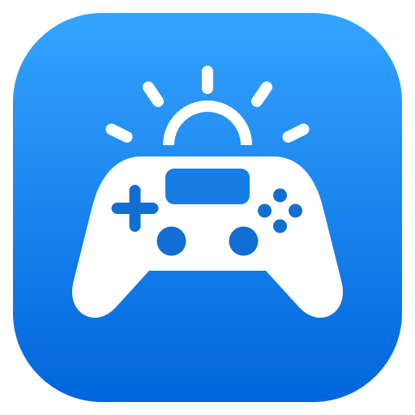

<p align="center">
  
</p>

<h1 align="center">TripleSense</h1>

<p align="center"><strong>Your DualSense here. Your games over there.</strong></p>

<p align="center">
  <a href="https://github.com/arwebSE/TripleSense/releases/latest">Download</a> ·
  <a href="#get-connected">Get started</a> ·
  <a href="#supported-platforms">Compatibility</a> ·
  <a href="docs/GUIDE.md">Help</a>
</p>

TripleSense connects a DualSense beside you to games running on another computer.
It forwards controller input and feedback, including adaptive triggers, vibration,
motion and touchpad reports, with a Bluetooth speaker and microphone path.
Individual games still decide which DualSense features they use.

Use it alongside your preferred game-streaming software, or on its own.
Sunshine and Moonlight are our tested streaming setup; neither is required.
TripleSense carries the controller connection. Your streaming app carries the
picture and normal game sound.

> **Preview software.** Mac-to-Windows input, vibration and adaptive triggers
> have been tested with a real controller. Bluetooth speaker and microphone
> signal tests have passed, but sustained audio, detailed haptics and broader
> game compatibility still need validation. See [current limitations](#current-limitations).

## Download

| Computer | Download | What to install |
| --- | --- | --- |
| Windows, 64-bit Intel/AMD | [Windows installer](https://github.com/arwebSE/TripleSense/releases/latest) | Run `TripleSense-Setup-…-Windows-x64.exe`. |
| Linux, ARM64 (experimental) | [Debian/Ubuntu package](https://github.com/arwebSE/TripleSense/releases/latest) | Install the `.deb` with your package manager. |
| macOS, Apple Silicon | [Mac disk image](https://github.com/arwebSE/TripleSense/releases/latest/download/TripleSense-macOS.dmg) | Open the DMG and drag TripleSense into Applications. |

**No Python, terminal commands or developer tools are needed.** The apps include
their runtime libraries. Windows setup includes the free signed USB/IP driver
and asks for administrator permission.

The repository is currently private: downloads require a GitHub account with
access. The Mac preview is not notarized, so macOS may require
[Open Anyway](https://support.apple.com/en-gb/102445) on first launch.

## Get connected

You need two computers, a DualSense connected over **Bluetooth**, and either the
same local network or a private VPN such as **Tailscale** or **NetBird**.

```text
DualSense ── Bluetooth ── Client computer ── LAN / VPN ── Server computer
                          beside you                     running the game
```

1. **Open TripleSense on the gaming PC.** Choose **Server** on Windows and
   start it. A four-digit pairing code appears automatically.
2. **Open TripleSense beside the controller.** Choose **Client** on Windows;
   the Mac app opens as Client automatically. Allow Bluetooth and local-network
   access when prompted, then turn on the controller.
3. **Add the Server on the Client.** Select it from the discovered servers, or
   enter its address. Enter the four-digit code and click **Connect**. You can
   click an address in the Server app to copy it.
4. **Start your game or stream.** If your streaming software also forwards
   controllers, disable its controller forwarding to avoid duplicate input.

Pairing is saved. Next time, open both apps and turn on the controller; select
the saved Server and click **Connect** if needed. You do not need another code.
The Client shows online/offline status for saved servers and lets you add or
remove them.

Keep both apps open while playing. **Minimize** to leave the connection running;
closing a window disconnects the controller and quits that app.

### Connecting over Tailscale or NetBird

Connect both computers to the same private VPN, then use the Server's VPN
address. Discovery checks LAN and known VPN peers automatically while adding
a Server. If it does not appear, enter the VPN address manually.

Your VPN access rules must allow the computers to communicate. The Windows
installer permits local subnets and the `100.64.0.0/10` range used by Tailscale
and default NetBird networks. Custom VPN ranges need a matching firewall rule.
Tailscale controller input and trigger feedback have passed live testing;
NetBird still needs a full live controller test.

## Supported platforms

**Client** is the computer connected to the physical controller.
**Server** is the computer running the game. A Mac is optional.

| Platform | Client | Server |
| --- | --- | --- |
| Windows x64 | Available; physical-controller testing pending | Available; tested with a Mac Client |
| macOS, Apple Silicon | Available; tested with a Windows Server | Planned |
| Linux | Development preview | Development preview |

Release **0.5.1** includes experimental Linux packaging, touchpad mouse mode
and in-app updates. The Linux download currently targets ARM64 Debian/Ubuntu.
Linux has passed isolated kernel input tests; physical Bluetooth and audio
testing are still pending. See the [Linux preview](docs/GUIDE.md#permissions-and-installation) for details.

## Controller audio

**Controller audio is enabled by default.** It carries the controller's speaker,
microphone and audio-driven haptics separately from your stream's normal sound.
Your game or operating system may need to select the virtual controller's audio
device for speaker or microphone use.

To change the option, disconnect first, toggle **Controller audio**, then
reconnect. Turning it off stops microphone capture and Bluetooth audio packets
while keeping ordinary controller input and feedback available.

## Current limitations

- **Bluetooth controllers only:** forwarding a controller connected by USB is
  planned.
- **Audio needs more testing:** successful speaker/microphone signal tests do
  not yet establish reliable full-duplex audio or detailed haptics in every game.
- **Touchpad as a mouse is experimental:** the current live Mac-to-Windows
  mouse test remains unresolved.
- **macOS Server is not available yet.** Linux Client and Server remain previews.
- **Other streaming apps need testing.** TripleSense works independently of the
  streaming app, but Sunshine/Moonlight is the combination validated so far.

## Need help?

| Problem | Try this |
| --- | --- |
| Server does not appear | Enter its LAN or VPN address manually. Check local-network permissions and VPN access rules. |
| Windows refuses the connection | Use **Settings → Repair Windows setup** to repair the driver and firewall rules. |
| Controller is asleep | Press **PS** to reconnect it. |
| Input or effects are missing | Close Steam on the Client computer and check for duplicate controller forwarding in your streaming app. |
| Audio drops out | Disconnect and turn off **Controller audio** to check input separately. Audio remains preview functionality. |

Open **Logs** in the app for connection details. More help is in the
[setup and troubleshooting guide](docs/GUIDE.md).

Use **Settings → Updates** to download an update and choose **Install and restart**.
Settings and pairings are kept. Versions before 0.5.1 need one manual update
using the Windows installer or replacement Mac app. See [updates](docs/GUIDE.md#updates).

## Open source

TripleSense is MIT-licensed and builds on
[Macle57's ds5-virtual-cable](https://github.com/Macle57/ds5-virtual-cable) and
usbip-win2. Its focus is a standalone, paired controller connection between
computers, with discovery, saved servers and desktop apps. See
[upstream credits and comparison](docs/UPSTREAM.md) and
[third-party notices](THIRD_PARTY_NOTICES.md).

Previously called **DSShine**. Renaming or updating keeps existing pairings.

Want to contribute? Start with the [development guide](docs/DEVELOPMENT.md) and
[compatibility and roadmap](docs/STATUS.md).
